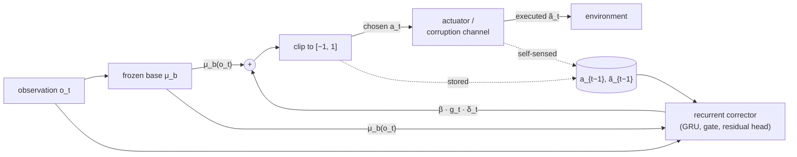
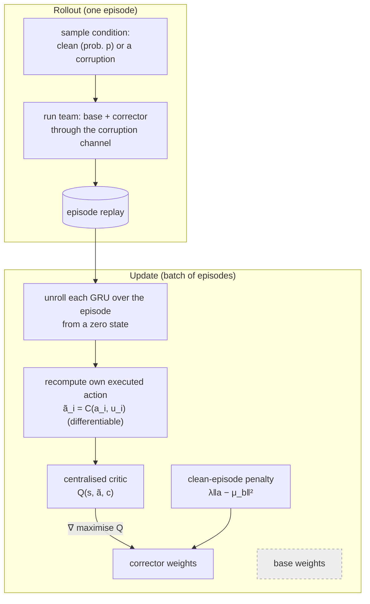

# Residual Correction (RC): core architecture

Notation follows `shared/formal_definition.md`: agent $i$ chooses $a_{i,t} \in [-1,1]^d$, and the
environment executes $\tilde a_{i,t} = \mathrm{clip}\big(C(a_{i,t}, u_{i,t})\big)$, where $C$ is
the corruption channel.

## Overview

RC makes a trained cooperative team robust to action corruption **without retraining it**. Each
agent keeps its pretrained policy, the *base*, frozen. A small recurrent *corrector* sits on
top of the base and adds a bounded correction to the base's action. The corrector watches one
signal the base ignores: the difference between the action the agent chose and the action that
was actually executed. When the two agree, the corrector stays silent. When they disagree
persistently, it infers how the actuator is being corrupted and adjusts the command so that
the *executed* action matches what the base intended.

## Per-agent policy

### Base

The base is a deterministic policy $\mu_{b,i}(o)$ trained by any cooperative MARL algorithm
(MADDPG and MAPPO in our experiments, where for MAPPO the mean action is used). Its weights are
never updated by RC.

### Corrector

At every step, agent $i$ forms the input

$$
x_t = \big[\,o_t,\; a_{t-1},\; \tilde a_{t-1},\; \mu_b(o_t)\,\big],
$$

that is, its observation, its previous chosen action, its previous executed action, and the
base's current proposal. The corrector then computes:

| Component | Computation | Role |
| --- | --- | --- |
| Encoder | $z_t = \mathrm{ReLU}(W_x x_t)$ | embeds the input |
| Memory | $h_t = \mathrm{GRU}(z_t, h_{t-1})$, with $h_0 = 0$ | accumulates evidence about the corruption across steps |
| Residual head | $\delta_t = \tanh(W_\delta h_t)$ | direction and size of the correction, in $[-1,1]^d$ |
| Gate | $g_t = \sigma(w_g^\top h_t + b_g)$ | how much of the correction to apply, in $(0,1)$ |

### Action

$$
a_t = \mathrm{clip}\big(\mu_b(o_t) + \beta\, g_t\, \delta_t,\; -1,\; 1\big), \qquad \beta = 2 .
$$

### Design properties

- **Identity at initialisation.** $W_\delta$ and its bias start at zero, so $\delta_t = 0$ and
  RC reproduces the base exactly before training. Training can only move away from a known-good
  policy.
- **Bounded authority.** The correction never exceeds $\beta$ per component. With $\beta = 2$,
  any action in the box is reachable from any base action. This matters for saturating bases,
  whose actions sit at $\pm 1$.
  - The residual is added **in action space**, after the base's squashing nonlinearity, not
    to its pre-activation. A pre-activation residual cannot move a saturated base: the base's
    own saturation absorbs the correction.
- **Evidence input.** The pair $(a_{t-1}, \tilde a_{t-1})$ is the only direct evidence of
  corruption. The executed action comes from self-sensing, such as actuator encoders or
  odometry. In simple physics it can be recovered exactly from two consecutive velocity
  readings.
- **Decentralised and lightweight.** Each agent's corrector uses only that agent's own
  signals. It adds one GRU (hidden size 64) per agent and has no communication.

## Training

RC trains the corrector of every agent jointly, with a centralised critic, while the base stays
frozen. The critic is used only during training. Execution needs only the per-agent policy
above.

### Critic

The critic is one centralised network $Q(s_t, \tilde a_t, c_t)$ trained on the shared team
reward.
- It conditions on the **executed** joint action, because that is what drives the dynamics.
- It also conditions on a *privileged* description $c_t$ of the current corruption, such as
  the fault's parameters, zero when clean. This makes the value of a command under a given
  corruption well defined.
- Its TD target passes the target policy's next action through the same channel.

### Actor

For agent $i$, the corrector maximises the critic's value, with its own executed action
recomputed through the channel from its current command (the other agents' executed actions
come from replay):

$$
\max_{\theta_i}\; \mathbb{E}\Big[\, Q\big(s_t,\; C(a_{i,t}, u_{i,t}),\; \tilde a_{-i,t},\; c_t\big) \Big]
\;-\; \lambda\, \mathbb{E}_{\text{clean}}\big[\, \|a_{i,t} - \mu_b(o_{i,t})\|^2 \big].
$$

The gradient flows through the channel, so the corrector learns which command produces the
executed action the critic values, which amounts to learning to invert the corruption. The
penalty term applies only on clean episodes. It keeps RC equal to the base when nothing is
wrong, so robustness is not paid for with clean performance.

### Schedule

- Each episode is clean with probability $p$ (0.25). Otherwise one corruption is drawn from the
  training distribution: a channel type, a strength, the victim agents and an onset step.
- The critic trains alone for a warm-up period. Then $\beta$ ramps linearly from 0 to its final
  value, so the correction's authority grows only once the critic is informative.
- Exploration adds Gaussian noise to the chosen action.

### Default hyperparameters

| Parameter | Value |
| --- | --- |
| GRU / encoder width | 64 |
| Critic width | 128 (two hidden layers) |
| Learning rate, actor / critic | 3e-4 / 1e-3 |
| γ, target-update τ | 0.95, 0.01 |
| Batch | 64 episodes |
| Training length | 20,000 episodes |
| Critic warm-up, β ramp | 2,000 / 8,000 episodes |
| Final β, clean penalty λ | 2, 1 |
| Exploration noise | 0.1 |

## What the architecture can and cannot correct

- **Correctable:** corruption that is persistent and that leaves the desired executed action
  inside the actuator's range. Examples are a constant bias within the action limits, a slow
  drift, and a misaligned (rotated) or sign-flipped actuator. The corrector identifies the
  corruption from $(a_{t-1}, \tilde a_{t-1})$ and inverts it.
- **Not correctable by the victim itself:** corruption that removes actuator authority.
  - Gain loss on an agent that already commands full force cannot be undone from inside
    $[-1,1]$.
  - Unpredictable per-step noise and a stuck actuator are also out of reach.
  - Here the only remaining lever is the *teammates'* behaviour, which the same objective can
    learn, since the critic is shared.
- **Detection delay limits the gain.** The corrector needs at least one corrupted step to
  observe the evidence. In fast tasks, where a few uncorrected steps decide the outcome,
  identification speed matters as much as the correction itself.
